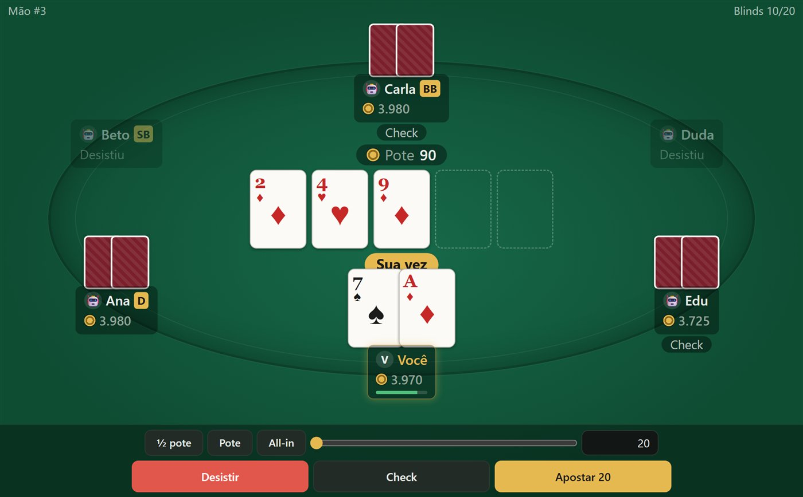
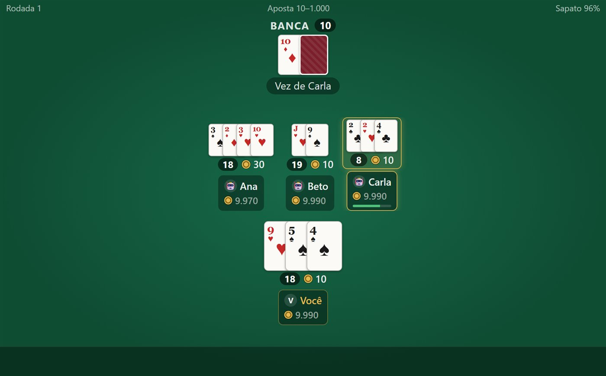
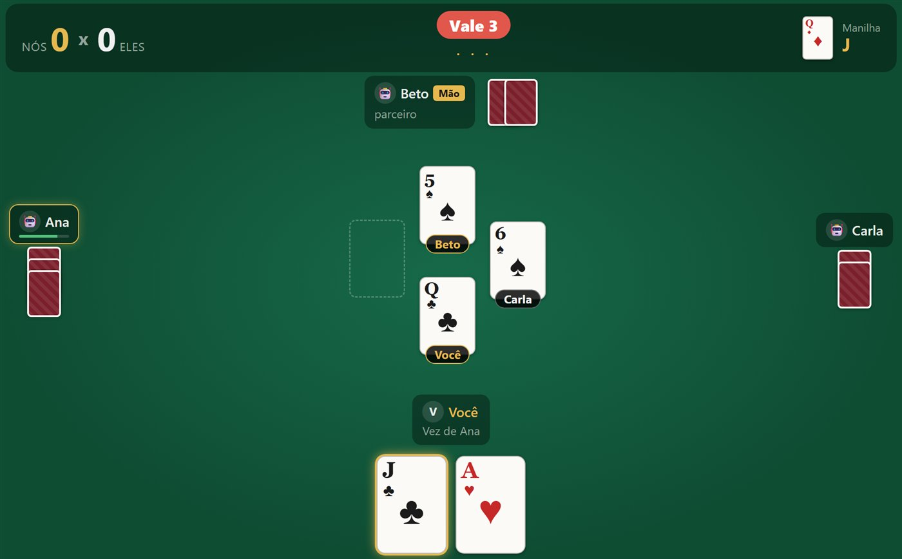
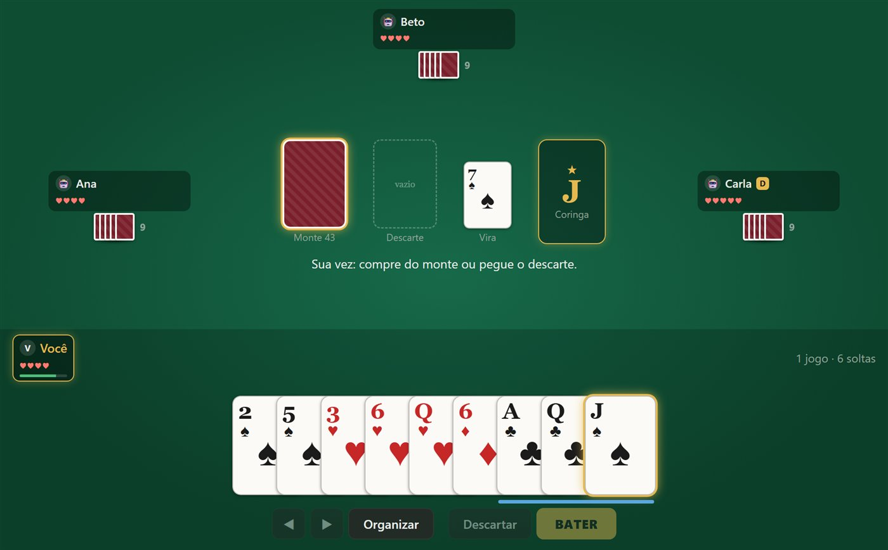
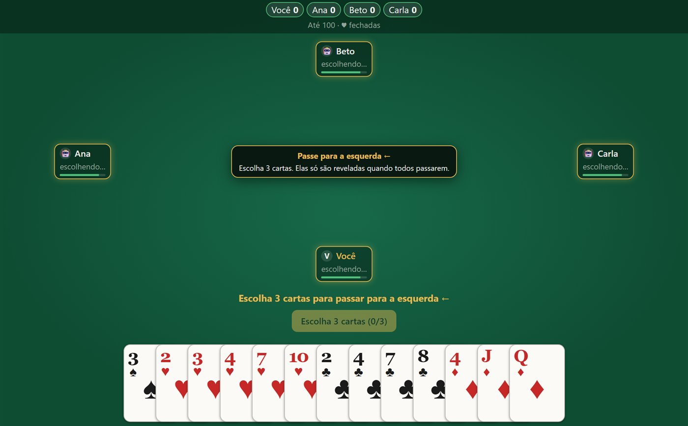
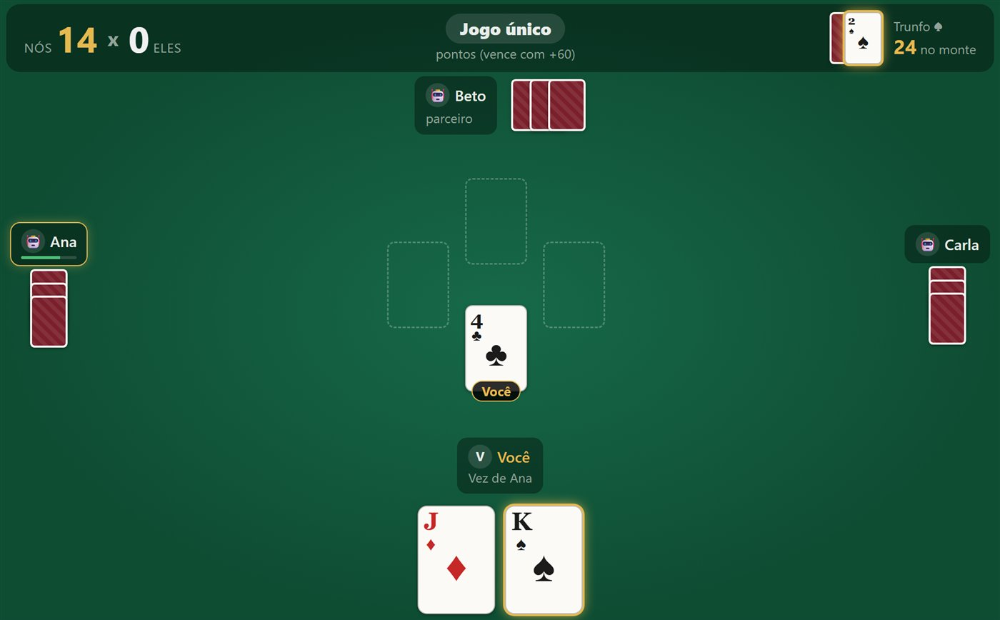
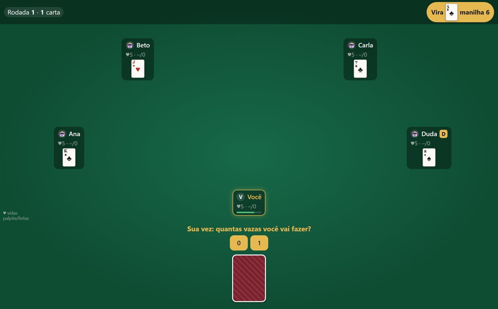
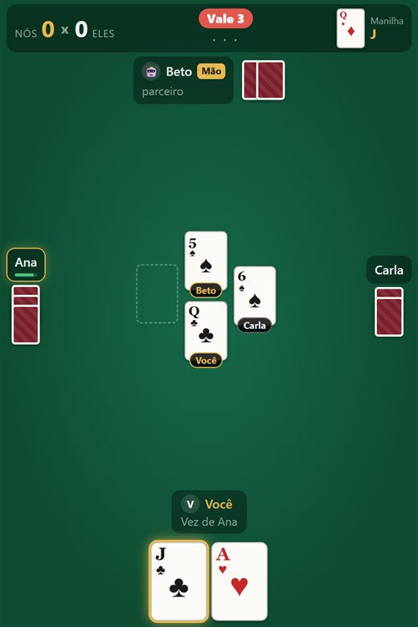
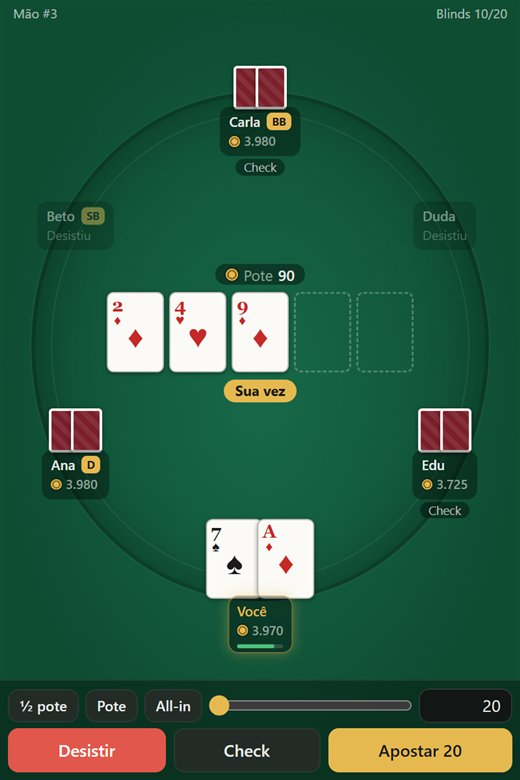

<div align="center">

# ♠ Mesa de Cartas

**Jogos de cartas online entre amigos, com fichas virtuais.**
Poker, Blackjack, Truco, Bisca, Sueca, Copas, Fodinha, Cacheta e Pife, no navegador ou numa janelinha flutuante no Windows.

[**🎮 Jogar agora**](https://cardgame.hchrist.com) &nbsp;·&nbsp; [**⬇️ Baixar para Windows**](https://github.com/harryChrist/poker-game/releases/latest/download/MesaDeCartas.exe)



</div>

## Os jogos

| | Jogo | Jogadores | Como é |
|---|---|---|---|
| 🃏 | **Poker Texas Hold'em** | 2–9 | No-Limit. Entre com fichas e saia quando quiser. |
| 🂡 | **Blackjack (21)** | 1–5 | Contra a banca. Blackjack paga 3:2, a banca para no 17. |
| ⚔️ | **Truco Paulista** | 2 ou 4 (duplas) | Com vira e manilha, truco, seis, nove e doze, mão de onze. Até 12 pontos. |
| 🎴 | **Bisca** | 2 ou 4 (duplas) | Bisca de 3 cartas com trunfo. Faça mais de 60 pontos. |
| 🤝 | **Sueca** | 4 (duplas) | 40 cartas, trunfo, seguir naipe. |
| ♥️ | **Copas** | 4 | Fuja das copas e da dama de espadas. Menor pontuação vence. |
| 🎯 | **Fodinha** | 2–8 | Aposte quantas vazas vai fazer. Errou, perde vida. |
| 🃟 | **Cacheta** | 2–6 | Trincas e sequências com coringa da vira. Bata primeiro. |
| 🂮 | **Pife** | 2–6 | Forme 3 jogos com 9 cartas e bata. |

Faltou gente? **Bots** completam a mesa.

<table>
  <tr>
    <td><br><sub><b>Blackjack</b>: até 5 jogadores contra a banca</sub></td>
    <td><br><sub><b>Truco Paulista</b>: em duplas, com a manilha no canto</sub></td>
  </tr>
  <tr>
    <td><br><sub><b>Cacheta</b>: organize a mão e bata</sub></td>
    <td><br><sub><b>Copas</b>: escolha as 3 cartas para passar</sub></td>
  </tr>
  <tr>
    <td><br><sub><b>Bisca</b>: trunfo e monte sempre à vista</sub></td>
    <td><br><sub><b>Fodinha</b>: na rodada de 1 carta você vê a dos outros, mas não a sua</sub></td>
  </tr>
</table>

## Salas e fichas

- **Fichas virtuais** (não é dinheiro de verdade): todo mundo começa com 10.000, ganha um bônus de 1.000 a cada hora e tem recarga grátis quando zera.
- **Salas públicas** aparecem no lobby. As **privadas** só abrem com o código de 6 letras que você manda para os amigos.
- **Tempo por jogada** configurável (de 15 s a 90 s), ou **sem limite** para cada um jogar no seu tempo. Quando o tempo acaba, o jogo pode jogar por você automaticamente ou tirar o jogador da mesa.
- **Chat** na mesa, **ranking**, **histórico** de partidas e painel de **admin**.
- Caiu a internet? Ao reconectar você volta para o mesmo lugar na mesa.

## App para Windows




Um "quadradinho" que fica num canto da tela enquanto você faz outras coisas:

- só **~430 KB**, um `.exe` sem instalação;
- **sem bordas**: arraste para qualquer lugar e redimensione como quiser;
- **sempre no topo** (liga/desliga);
- **transparência** ajustável;
- **atalho global** para esconder/mostrar na hora (padrão `Ctrl+Shift+Espaço`);
- fica no **ícone da bandeja**: fechar não encerra o app;
- **atualiza sozinho**.

Precisa do WebView2, que já vem no Windows 10/11.
[Baixar o MesaDeCartas.exe](https://github.com/harryChrist/poker-game/releases/latest/download/MesaDeCartas.exe) (ou em https://cardgame.hchrist.com/desktop/MesaDeCartas.exe).

<br clear="right">

---

## Para desenvolvedores

Monorepo em TypeScript: servidor **Node + Socket.IO + SQLite**, web app **React + Vite**, motores de regras puros e testados,
e o app desktop em **C# + WebView2**.

```bash
npm install
npm run dev:server     # API + jogo em http://localhost:4080
npm run dev:client     # Vite em http://localhost:5173 (hot reload)
npm test
npm run build          # web app + servidor
npm run build:exe      # app desktop (Windows)
```

Galeria das telas de jogo sem servidor (dev): http://localhost:5173/?gallery=all

**Atualizar o servidor:** depois do push, rode `bash scripts/deploy.sh` na VPS (pull, build e restart). Quem estiver com o jogo aberto, no navegador ou no app, recarrega sozinho na versão nova.

Mais detalhes: [HANDOFF.md](HANDOFF.md) (o que falta para pôr no ar) · [ARCHITECTURE.md](ARCHITECTURE.md) · [DEPLOY.md](DEPLOY.md) · [apps/desktop/README.md](apps/desktop/README.md)
